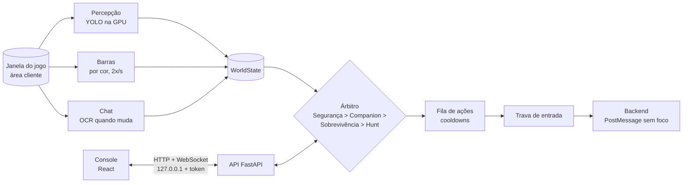

# OTP Bot

Automação com visão computacional e IA para **Poke Alliance** (OT Pokémon / Poketibia), com console próprio por abas.

> "OTP" aqui significa **OT Pokémon**. O projeto não tem relação com One Time Password.

O bot não lê a memória nem mexe no cliente do jogo. Ele **olha a tela** (captura de tela, cores, template matching e YOLO na GPU), **decide** o que fazer e **aperta teclas e clica** como um jogador.

> ⚠️ Uso pessoal. Muitos servidores proíbem automação nas regras; o risco de usar é de quem usa.

---

## Sumário

- [Como funciona](#como-funciona)
- [Funcionalidades](#funcionalidades)
- [Requisitos](#requisitos)
- [Instalação](#instalação)
- [Primeiro uso](#primeiro-uso)
- [Atalhos](#atalhos)
- [Configuração e arquivos de dados](#configuração-e-arquivos-de-dados)
- [Estrutura do projeto](#estrutura-do-projeto)
- [API local](#api-local)
- [Desenvolvimento](#desenvolvimento)
- [Limitações conhecidas](#limitações-conhecidas)
- [Documentos do projeto](#documentos-do-projeto)

---

## Como funciona



Tudo roda num único processo Python (`main.py`), com tarefas `asyncio` em paralelo:

| Tarefa | O que faz |
|---|---|
| **Percepção** | Captura só a área cliente da janela do jogo (em qualquer monitor) e roda o YOLO (CUDA + FP16 quando há GPU) para achar seu pokémon, selvagens e corpos. |
| **Barras** | Lê 2x por segundo as barras fixas da interface: HP do jogador, HP do pokémon, EXP, Pokébar e a postura (mãos). |
| **Chat** | Lê a região do chat (a da Calibração) só quando ela muda (MSE) e avisa se aparecer GM/Admin. |
| **Árbitro** | A cada frame dá o controle ao comportamento mais importante: a **Segurança** desliga o bot com GM; a **Hunt** faz combo, defesa quando cercado, postura automática, cura com pokémon e captura. Relê o `config.json` a cada frame: mudanças no console valem na hora. |
| **API + console** | Servidor local que entrega o console e recebe os comandos dele. |

O bot **abre pausado**: nada é apertado até você dar Play no console ou apertar a hotkey de pausa. Toda tecla e
todo clique passam pela fila e pela trava de entrada; pausar corta a entrada na hora.

**Entrada sem foco:** por padrão as teclas e cliques vão direto para a janela do jogo (PostMessage), sem roubar o
foco nem mexer no seu cursor; você pode usar o outro monitor enquanto o bot joga. Alternativa em `config.json`:
`"input": {"backend": "foreground"}` (foca o jogo, aperta e devolve o foco). O jogo roda como administrador, então
**o bot também precisa rodar como administrador** (D20); se não estiver, o log avisa ao achar o jogo.

**O jogo precisa estar visível** (sem outra janela por cima): a captura copia a tela. Com o jogo coberto, os sensores
ficam sem leitura e o bot não age.

---

## Funcionalidades

Cada seção do console mostra um selo: **Funcionando** (o bot já executa) ou **Em breve** (a configuração já fica salva, mas o bot ainda não executa).

### Início
- Estado do bot (rodando / pausado), Play/Pause e desligar.
- Liga/desliga rápido das funções principais.
- **Leitura ao vivo da tela**: HP do jogador, HP do pokémon, EXP, postura e vida de cada pokémon do time.
- Telemetria: hardware da visão (GPU/CPU), FPS, detecções, mobs na tela, tempo de sessão.
- Log ao vivo do que o bot está fazendo, e avisos (modelo de visão ausente, tecla não definida…).

### Combate
| Função | Status | Descrição |
|---|---|---|
| Combo em área | Funcionando | Solta o combo quando aparecem selvagens; pode combar enquanto anda. |
| Defesa quando cercado | Funcionando | Com N selvagens colados no seu pokémon: defesa → combo → revive em sequência, e para a rota. Limite de mobs e raio configuráveis. |
| Postura automática | Funcionando (desligada por padrão) | Clica na mão do painel Pokémon conforme a fase: **normal**, **juntando (lure)** ou **cercado (combo)** → ofensivo / neutro / defensivo. Só clica se a postura atual foi lida com segurança. |
| Mira automática | Em breve | Alvo único, alcance, prioridade de shiny, lista de ignorar. |

### Cura
| Função | Status | Descrição |
|---|---|---|
| Revive | Funcionando | Usado na defesa quando cercado e na cura com pokémon. |
| **Cura com pokémon** | Funcionando (ligar manualmente) | Com o HP abaixo do limite (ex: 90%) e **sem selvagens por perto**: chama o pokémon de cura → faz a **rotação de cura** → usa **revive** nele (zera a recarga das skills) → chama de volta o **pokémon de farm**. Se aparecer selvagem no meio, aborta e volta ao farm. Troca de pokémon **clicando na Pokébar** ou **por tecla**. Tem botões para testar no jogo. |
| Poção de vida | Em breve | Poção quando o HP cair. |
| Medicine | Em breve | Cura de status do pokémon. |

### Itens
Biblioteca de **sprites**: você tira um print pelo console (3s para trocar para o jogo), **arrasta um retângulo em volta do item** e escolhe a categoria (**Poções, Antídotos, Revive, Buffs, Pokébolas, Outros**) e a tecla. Também aceita enviar um PNG. O botão **Testar** procura o item num print novo e mostra a semelhança (ex: 96%).
*Reconhecimento: funcionando. Uso automático dos itens: em breve.*

### Rota (cavebot)
- **Gravar**: você clica no minimapa e o bot grava os pontos e o tempo entre eles.
- **Tocar**: repete a rota em loop com movimento de mouse humanizado.
- Lista dos pontos gravados no console.
*Os pontos são posições da tela; mudar a janela do jogo de lugar exige gravar de novo.*

### Captura
Depois que um selvagem morre, aperta a tecla da pokébola e clica no corpo (só sem selvagens vivos na tela).

### Segurança
| Função | Status |
|---|---|
| Monitor de GM no chat (precisa do Tesseract; lê a região **Chat** da aba Calibração) | Funcionando |
| Alertas (jogador na tela, PM, morte, som) | Em breve |
| Avisos no Telegram | Em breve |

### Calibração
Onde fica cada coisa na tela. **A interface do jogo tem o mesmo tamanho em pixels em qualquer monitor**, então há **um perfil por resolução**, já medido nos prints do jogador:

- `3440 × 1440`
- `1920 × 1080`

O bot escolhe o perfil pelo tamanho da tela. Uma resolução nova cria um perfil a partir do mais parecido.

Regiões lidas por cor (funcionando):

| Região | Onde | Como |
|---|---|---|
| HP do jogador | Barra **vermelha** do painel Pokémon | % preenchido |
| HP do pokémon | Barra **azul** do painel Pokémon | % preenchido |
| Postura | As 3 mãos: 🔴 ofensivo · ⚪ neutro · 🟢 defensivo | Fundo mais claro = ativa |
| EXP | Barra amarela embaixo do jogo | % preenchido |
| Pokébar | Barras verdes dos pokémons do time | % de cada um |

Regiões marcadas para as próximas funções: área do jogo, lista Batalha, golpes, hotbar, minimapa, coordenadas (`x, y, z`) e chat.

No console você troca o perfil, clica numa região e **arrasta na imagem para redesenhar**. Os botões são **Ler na imagem** e **Usar print atual**.

### Atalhos
Seletor de teclas com lista (F1–F12, Ctrl+F, Shift+F, números) ou captura apertando a tecla. Uma tecla não definida fica em amarelo, o bot pula a ação e avisa no Início.

### Ajustes
FPS da visão, confiança mínima da IA e arquivo do modelo.

### Extras e Guild
Comida automática e daily da guild: *em breve* (configurações já salvas).

---

## Requisitos

| | Versão usada | Observação |
|---|---|---|
| Windows | 10 / 11 | Captura de tela e entrada de teclado/mouse são do Windows. |
| Python | 3.14 | |
| Node.js | 24 | Só para compilar o console. |
| GPU NVIDIA | RTX 5060 Ti (8 GB) | Opcional. Sem GPU a visão roda na CPU. Placas RTX 50xx precisam de PyTorch com CUDA 12.8+. |
| Tesseract OCR | — | Opcional, para o monitor de GM. Caminho padrão: `C:\Program Files\Tesseract-OCR\tesseract.exe`. |

---

## Instalação

PyTorch com CUDA primeiro (antes do resto):

```bash
pip install torch torchvision --index-url https://download.pytorch.org/whl/cu130
```

Dependências Python:

```bash
pip install -r requirements.txt
```

Compilar o console:

```bash
cd frontend
npm install
npm run build
cd ..
```

Conferir se a GPU está ativa (deve imprimir `True`):

```bash
python -c "import torch; print(torch.cuda.is_available())"
```

---

## Primeiro uso

```bash
python main.py
```

Abre a janela do console (pywebview). Fechar a janela desliga o bot. Opções:

| Opção | Efeito |
|---|---|
| `--no-window` | Não abre janela; imprime o link do console para abrir no navegador. |
| `--port 8000` | Porta local da API/console. |

Passo a passo recomendado:

1. **Calibração**: com o jogo aberto, confira se a *Leitura ao vivo* bate com o jogo (HP, EXP, postura). Se não bater, clique em **Usar print atual**.
2. **Atalhos**: escolha as teclas do combo, defesa, revive e pokébola.
3. **Cura → Cura com pokémon**: escolha o curador, o pokémon de farm e a rotação. Use os botões de teste antes de ligar.
4. **Combate**: ajuste o combo, a defesa e, se quiser, a postura automática.
5. **Play** no console (ou F8).

---

## Atalhos

Padrões (mudam na aba **Atalhos**):

| Tecla | Ação |
|---|---|
| F8 | Pausar / retomar |
| F9 | Desligar o bot |
| F10 | Gravar rota (liga/desliga) |
| F11 | Tocar / parar rota |

---

## Configuração e arquivos de dados

Os seus dados ficam em **`%APPDATA%\OTPBot`** (ex: `C:\Users\<você>\AppData\Roaming\OTPBot`), fora da pasta do código.
A variável de ambiente `OTPBOT_DATA_DIR` troca essa pasta.

| Arquivo (dentro de `%APPDATA%\OTPBot`) | Conteúdo |
|---|---|
| `config.json` | Toda a configuração do console (funções, teclas, cooldowns, calibração por resolução). O console salva sozinho. Chaves novas são completadas com os padrões de `otpbot/interface/config_manager.py`. |
| `calibration/reference_<resolução>.png` | Print de referência de cada perfil de calibração. Na primeira execução vêm os padrões de `defaults/calibration/`. |
| `sprites/` | Sprites dos itens (`<id>.png`) e o índice `sprites.json`. |
| `models/otp_yolo.pt` | Modelo de visão. Sem ele a visão roda em modo *mock* e não detecta nada. Caminho relativo no config vale a partir desta pasta. |
| `route.json` | Rota gravada do cavebot. |
| `logs/otpbot.log` | Log de cada execução (5 arquivos de até 2 MB). |

**Migração automática:** na primeira execução depois da reorganização (E02), o bot **copia** para cá o que achar no
lugar antigo, ao lado do código (`config.json`, `route.json`, `assets/sprites/`, `assets/calibration/`, `models/`). A
cópia nunca sobrescreve um arquivo que já existe aqui e **nunca apaga o original**; depois de conferir, você pode apagar
os arquivos antigos.

---

## Estrutura do projeto

```
main.py                       Entrada: loop do bot, API e janela do console
otpbot/
  app/
    paths.py                  Pastas de dados (%APPDATA%\OTPBot) e migração dos arquivos antigos
    runtime.py                Estado compartilhado (pausa, kill, telemetria, hotkeys)
  platform/
    game_window.py            Janela do jogo, monitor, foco, DPI, "coberta?" e captura da área cliente
    input_backend.py          ÚNICO lugar que manda tecla/clique: PostMessage sem foco (padrão) ou primeiro plano
  perception/
    capture.py                GameLocator: print só da área cliente do jogo (sensores e console)
    bars.py                   Perfis por resolução (tela cheia e área cliente) e leitura de barras/postura
    chat.py                   OCR do chat (monitor de GM -> gm_alert)
    sprites.py                Sprites de itens e template matching
    spatial_analyzer.py       Distância dos selvagens ao seu pokémon ("cercado")
    vision_engine.py          YOLO (CUDA/FP16)
  state/
    world_state.py            WorldState: leituras com valor, confiança e idade
  brain/
    arbiter.py                Árbitro: Segurança > Companion > Sobrevivência > Hunt, com interrupção
    behaviors/                safety (GM -> desliga), companion e survival (E10), hunt (combo, defesa,
                              postura, cura, captura)
    heal_routine.py           Rotina de cura com pokémon
  actuation/
    action_queue.py           Fila de ações (FIFO) com cooldowns; confere a trava antes de cada envio
    input_lock.py             Trava de entrada: um dono por vez
    mouse.py                  Mouse com curva Bézier, easing e ruído (só no backend de primeiro plano)
  hunts/
    navigator.py              Cavebot por pixel (gravar e tocar rota); sai na E09
  interface/
    api_server.py             API FastAPI + WebSocket de logs + console compilado
    config_manager.py         config.json com padrões e migração
defaults/calibration/         Prints de referência padrão (copiados para os dados na 1ª execução)
frontend/                     Console (React + Vite + Tailwind)
  src/schema/features.js      Abas, seções e campos do console (gerados a partir daqui)
tests/                        Testes (pytest)
tools/                        Scripts avulsos (spike de entrada, análise de vídeos)
```

---

## API local

A API só escuta em `127.0.0.1`. Cada execução gera um **token** novo; sem ele toda rota responde `401`. O console recebe o token pela URL ao abrir e depois o tira da barra de endereço.

| Método | Rota | Para quê |
|---|---|---|
| GET / POST | `/api/config` | Ler / salvar a configuração |
| GET | `/api/status` | Estado, telemetria e leituras da tela |
| POST | `/api/control` | `start`, `pause`, `toggle`, `stop`, `cavebot_toggle`, `record_toggle` |
| GET | `/api/route` | Pontos da rota |
| POST | `/api/heal/test` | Testar a cura: `healer`, `farm` ou `full` |
| POST | `/api/screenshot` | Print da tela (com espera) |
| GET / POST | `/api/sprites` | Listar / criar sprite (recorte do print ou PNG) |
| GET | `/api/sprites/{id}/image` | Imagem do sprite |
| PATCH / DELETE | `/api/sprites/{id}` | Editar / remover |
| POST | `/api/sprites/{id}/test` | Procurar o sprite num print novo |
| GET | `/api/calibration/reference/{perfil}` | Print de referência do perfil |
| POST | `/api/calibration/reference` | Salvar print atual como referência |
| POST | `/api/calibration/test` | Ler as barras na referência ou na tela |
| WS | `/ws/logs?token=` | Log ao vivo |

Header: `X-OTP-Token: <token>`.

---

## Desenvolvimento

Testes:

```bash
python -m pytest
```

Console com recarga automática: rode o bot sem janela e o Vite em outro terminal. O Vite repassa `/api` e `/ws` para o bot, e o link com token aparece no log do bot.

```bash
python main.py --no-window
```

```bash
cd frontend
npm run dev
```

As abas e os campos do console vêm de `frontend/src/schema/features.js`: para expor uma configuração nova, adicione o campo ali apontando para o caminho no `config.json` e leia esse caminho no backend.

---

## Limitações conhecidas

- **Sem modelo YOLO treinado.** A visão roda em modo *mock*: não vê selvagens nem corpos. Por isso combo, defesa, captura e "área limpa" da cura ainda não reagem ao jogo de verdade. Próximo passo: dataset com prints do Poke Alliance e treino.
- **Troca de pokémon pela Pokébar** clica no meio da linha do pokémon. Falta confirmar no jogo se um clique simples troca; se não, use a troca por tecla.
- **Cavebot** usa posições da tela, não coordenadas do mapa (as coordenadas do minimapa já estão marcadas na calibração para isso).
- A barra roxa de golpes ainda não está marcada no perfil 1920×1080.
- **Teclas com modificador** (`ctrl+f1`, `shift+f1`) em segundo plano não foram testadas no jogo: o cliente pode ler
  o Ctrl/Shift real do teclado. Se não funcionar, use teclas sem modificador ou o backend `foreground`.
- O painel de baixo (EXP, hotbar, chat) e a Battle mudam de lugar quando você redimensiona a interface do jogo:
  confira a *Leitura ao vivo* na Calibração depois de mexer no layout.

---

## Documentos do projeto

| Arquivo | Conteúdo |
|---|---|
| **`GUIA.md`** | **Documento-mestre:** estado atual, etapas E01–E17 da v1.0, protocolo de cada conversa e registro de passagem. |
| `docs/ESPECIFICACAO.md` | Regras do jogo e do bot da v1.0 (da anamnese). |
| `docs/ARQUITETURA.md` | Arquitetura alvo, executável, riscos e decisões. |
| `docs/analise-bot-externo/` | Comparativo com um bot externo e relatórios dos vídeos. |
| `ActiveContext.md` | Diário das fases: decisões tomadas, bloqueios e próximos passos. |
| `DESIGN.md` | Diretrizes de arquitetura. |
| `task.md` | Fluxo de trabalho do projeto. |
| `CLAUDE.md` | Contexto para assistentes de IA. |
