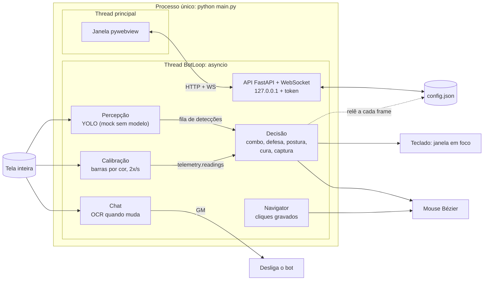
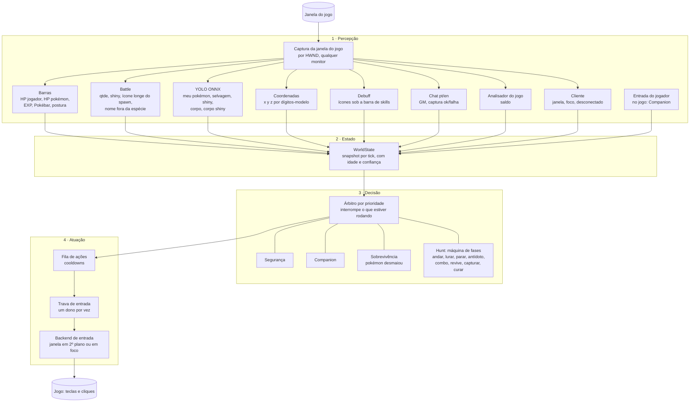
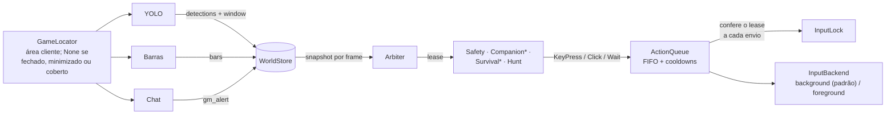
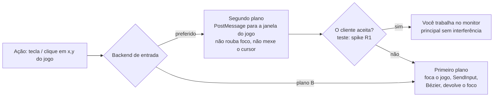
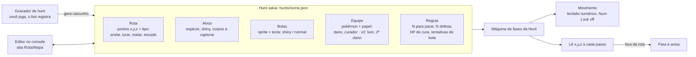
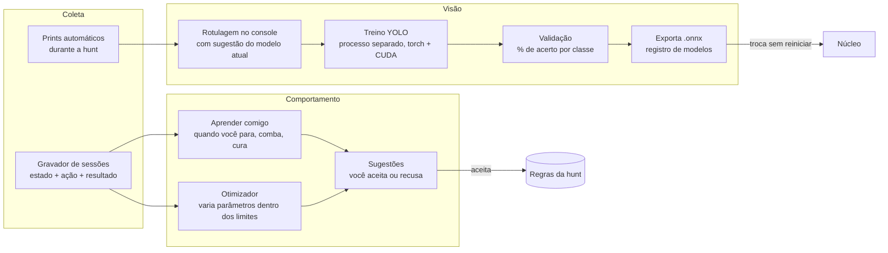
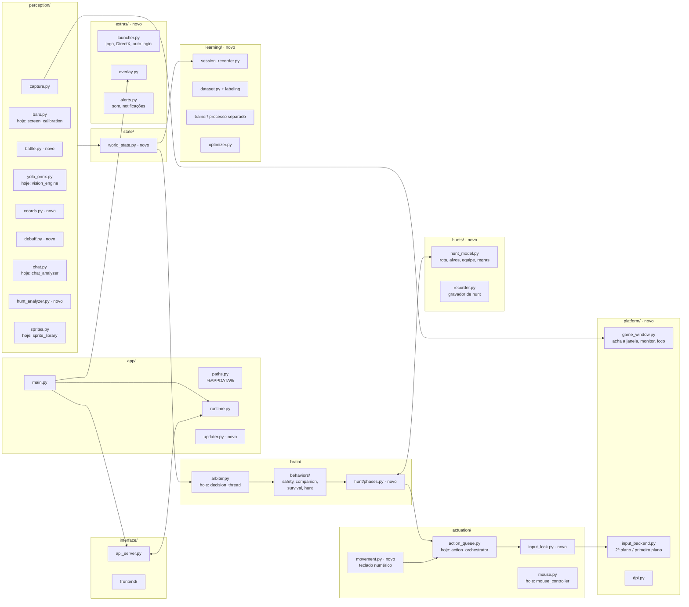
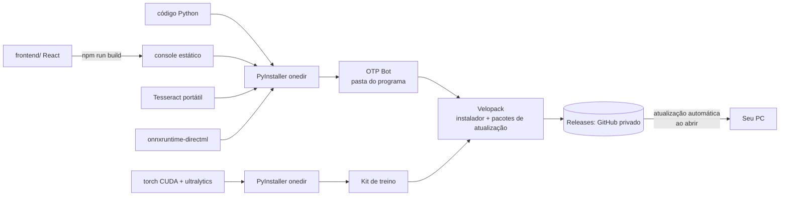
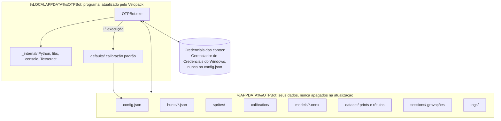
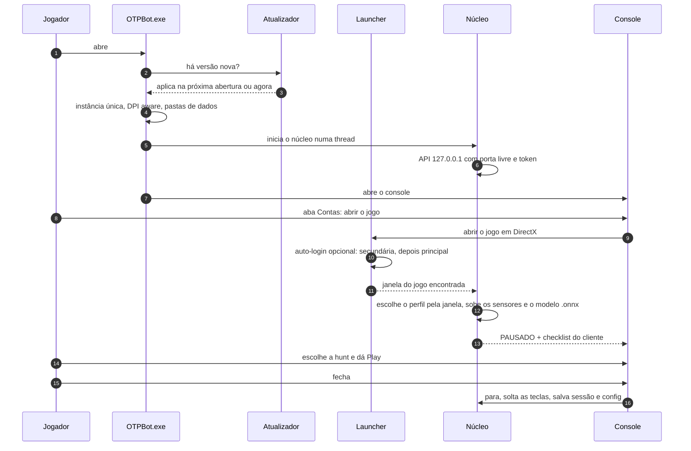

# Arquitetura do OTP Bot

**Versão 2**, revisada com as respostas da anamnese (2026-10-09). Regras do jogo em
[`ESPECIFICACAO.md`](ESPECIFICACAO.md); etapas e estado do projeto em [`GUIA.md`](../GUIA.md).
Decisões na **seção 10** (D1–D19 **aprovadas em 2026-10-09**; D11 confirmada na E01; D20–D22 das etapas E01 e E03);
riscos na **seção 9**. Como o núcleo ficou depois da E03: **§3.1**.

**O que mudou desde a versão 1:**
- O jogo fica no **monitor secundário** enquanto você usa o primário → entrada sem foco (risco R1), captura por janela e
  Companion que só reage ao que você faz **no jogo**.
- Rota por **coordenadas + teclado numérico**, gravada **jogando**. Sai o clique no minimapa e sai a ideia de seguir
  *Map Marks*.
- Visão: **YOLO** (posições de selvagens e corpos) **+ leitor da Battle** (contagem, shiny, ícone de "longe do spawn",
  nomes estranhos = GM). Os dois são necessários.
- Hunt como **máquina de fases** dentro do árbitro de prioridades.
- Peças novas: **aprendizado** (gravador, rotulagem, treino, otimizador), **launcher/auto-login**, **overlay**,
  **instalador com atualização automática**, **kit de treino** separado.
- Preparado para a v2 (**equipe de 6 pokémons com papéis**).

---

## 1. Como é hoje



| Problema | Consequência |
|---|---|
| Captura da **tela inteira** (monitor principal) | Com o jogo no monitor secundário, o bot olha o lugar errado |
| Teclas vão para a **janela em foco** | Enquanto você usa o monitor principal, as teclas iriam para o seu programa, não para o jogo |
| Sensores entregam por caminhos diferentes | A decisão junta tudo na mão |
| Decisão = um `if` grande | Cada regra nova (antídoto, captura confirmada, parada por ícone…) aumenta o emaranhado |
| Rota, cura e captura usam o mouse **sem coordenação** | Conflito no meio de uma captura ou de uma troca |
| Rota por pixel da tela | Não serve para andar pelo teclado numérico com coordenadas |
| Dados ao lado do código | Não funciona instalado |

---

## 2. Visão geral: processos

```mermaid
flowchart TB
    subgraph app["OTPBot.exe: processo principal"]
        direction TB
        janela["Console: janela pywebview"]
        overlay["Overlay sobre o jogo<br/>transparente, não recebe clique"]
        nucleo["Núcleo do bot: asyncio<br/>percepção · estado · decisão · atuação"]
        apiL["API local 127.0.0.1 + token"]
        launcher["Launcher<br/>abre o jogo, DirectX, auto-login"]
        gravador["Gravador de sessões"]
    end

    subgraph treino["otpbot-trainer: processo separado, opcional"]
        trainer["Treino YOLO: torch + CUDA<br/>só no PC principal"]
    end

    jogo[("Cliente Poke Alliance<br/>monitor secundário")]
    dados[("%APPDATA%\\OTPBot<br/>config, hunts, sprites,<br/>dataset, modelos, sessões")]
    cred[("Gerenciador de Credenciais<br/>do Windows")]
    upd[("Servidor de atualização")]

    janela <--> apiL <--> nucleo
    overlay <-- "WorldState" --- nucleo
    nucleo <-->|"captura da janela + entrada"| jogo
    launcher -->|"abre e loga"| jogo
    launcher <--> cred
    nucleo --> gravador --> dados
    nucleo <--> dados
    apiL -->|"iniciar treino"| trainer
    trainer <--> dados
    app -.->|"verifica versão"| upd
```

O treino roda **em outro processo**, com prioridade baixa e limite de memória de vídeo, para não derrubar o FPS do jogo
nem do bot. A atualização do modelo é feita **sem reiniciar**: o núcleo troca o `.onnx` quando o treino termina.

---

## 3. Núcleo: camadas



### Regras
1. **Sensor não decide.** Publica `valor`, `confiança` e `timestamp`; leitura incerta = `None` e ninguém age sobre ela.
2. **Cada pergunta tem a fonte certa:**

| Pergunta | Fonte principal | Conferência |
|---|---|---|
| Quantos selvagens? Tem shiny? Algum longe do spawn? | **Battle** | YOLO |
| Onde estão os selvagens e os corpos na tela? Qual corpo é shiny? | **YOLO** | cor do corpo |
| Tem GM ou jogador? | **Battle** (nome fora da espécie da hunt / linha de jogador) | YOLO (classe jogador, v1.1) |
| Onde estou? | **Coordenadas** | minimapa |
| Capturou? | **Chat** | corpo sumiu |

3. **Prioridade fixa e simples no topo:** Segurança > Companion > Sobrevivência > Hunt. A Hunt é uma **máquina de fases**,
   porque o ciclo tem ordem (ver `ESPECIFICACAO.md` §2). Quando algo de cima interrompe, a fase atual faz a **limpeza**
   (ex.: volta para o pokémon de dano) e a Hunt retoma do ponto certo.
4. **Um dono por vez da entrada.** Toda tecla e todo clique passam pela fila e pela trava.
5. **Config ao vivo**, como hoje.

### 3.1 Como ficou na E03 (2026-10-10)


\* Companion e Sobrevivência existem no árbitro mas nunca pedem o controle até a E10.

| Peça | Arquivo | Contrato |
|---|---|---|
| WorldState | `state/world_state.py` | `WorldStore.publish(nome, valor, confiança)`; `snapshot()` → `WorldState.get(nome, max_age, min_conf)`: vencida (barras > 3 s, detecções > 1 s), incerta ou com pouca confiança = `None` |
| Comportamento | `brain/behaviors/base.py` | `priority` (0 Segurança … 3 Hunt), `wants(ws, cfg)`, `step(ws, cfg, lease)` (pode ser longo: roda numa task cancelável), `cleanup(lease)`, `allows_cleanup` |
| Árbitro | `brain/arbiter.py` | tick a cada `detections`/`gm_alert` novo; o mais importante que quer age; interromper = cancelar a task de baixo e, se o novo permite (D21), deixar a limpeza sair **antes** de trocar a trava. Pausa/kill = `halt()` (revoga a trava, cancela, solta teclas). `run_exclusive` para os botões de teste do console |
| Ação e fila | `actuation/action_queue.py` | `KeyPress(key)`, `Click(x, y)` em pixels **do cliente**, `Wait(s)`; `execute(lease, nome_cooldown, *ações)` e `send(lease, *ações)`; um envio por vez, na ordem; trava conferida antes de cada envio. `CURRENT_LEASE` (ContextVar) leva o lease da task para a rotina de cura |
| Trava | `actuation/input_lock.py` | `grant(dono, prioridade)` → `Lease` (o de cima revoga o de baixo), `is_valid`, `release`, `revoke_all` |
| Backend | `platform/input_backend.py` | `key(nome)`, `click(x, y)`, `release_all()`. `background` = PostMessage igual ao spike; `foreground` = foca, SendInput, Bézier, devolve o foco. `config.input.backend`. `check_integrity` (D20) ao achar a janela |

Prova de que nada sai fora da trava: `tests/test_input_guard.py` (varredura do código: só o `input_backend.py` chama
APIs de entrada do Windows; e cenários com backend gravador: todo envio tinha dono válido).

---

## 4. Entrada e o monitor secundário (risco R1)

Você usa o monitor principal enquanto o jogo roda no secundário. `SendInput` (o que o bot usava até a E02) manda a tecla
para a **janela em foco**, então ela iria para o seu programa. A solução é um **backend de entrada** trocável
(implementado na E03, §3.1):



- **Captura** também vai pela **janela do jogo** (HWND): acha a janela, lê o retângulo dela em qualquer monitor e escolhe
  o perfil de calibração pelo tamanho da janela.
- **Mouse humanizado** (Bézier) só se aplica no plano B. No modo de segundo plano o cursor não se move.
- **Companion:** só conta como "você assumiu" o que você faz **com o jogo em foco** ou com o **mouse sobre a janela do
  jogo**. Mexer no monitor principal não pausa a hunt.

### 4.1 Resultado do spike R1 (E01, 2026-10-09)

Ferramenta: `tools/spike_input.py` (uma entrada por execução, print antes/depois em `docs/e01/spike/`). Janela:
`otpbot/platform/game_window.py`. Cliente em DirectX, **maximizado com barra de título** (não tela cheia).

**Janela do cliente:** classe **`PokeAllianceV3`**; título `Service` e processo `AudioEngine.exe` (disfarçados, não
servem de chave). Sem janelas-filhas: a entrada vai direto para a janela principal.

**Permissão (achado bloqueante):** o jogo roda com **integridade alta (administrador)**; o processo foi aberto junto com
um bot externo injetável, e não testamos o jogo aberto sem ele. Um processo comum (integridade média) recebe
**`Access is denied`** no `PostMessage` (UIPI do Windows); o `SendInput` do plano B é descartado pela mesma regra.
**Rodando como administrador, o PostMessage passa** → D20.

| Entrada (PostMessage, bot como administrador, jogo **sem foco**) | Tentativas | Resultado |
|---|---|---|
| Numérico **8** com Num Lock desligado (`VK_UP` + scan `0x48`, sem o bit *extended*) | 3 | ✅ 3/3: andou 1 sqm |
| **F5** (`VK_F5` + scan `0x3F`; na hotbar do usuário = chamar o pokémon selecionado) | 5 | ✅ 2/2 com o pokémon na bola (uma no 3440/principal, uma no 1920/**secundário**). As outras 3 sem efeito visível: em 2 o pokémon já estava fora; em 1 estava na bola e nada aconteceu (causa não confirmada; o usuário cita o pokémon "selecionado" na Pokébar) |
| **Clique esquerdo** no chão (`WM_MOUSEMOVE` + `WM_LBUTTONDOWN/UP`, x,y do cliente) | 1 | ✅ andou até o ponto; o cursor do usuário não se moveu |
| Foco do usuário depois de cada envio | todas | ✅ continuou na janela de antes; o jogo nunca ganhou foco |

**Não testado:** as outras setas do numérico, F1–F4 e F6–F12 (mesmo mecanismo da F5 e do 8, mas sem evidência),
clique direito, `SendMessage`, plano B (primeiro plano). O plano B fica no `spike_input.py` (`--method foreground`).

**Captura:** cópia da região do cliente na tela (mss) funciona com o jogo **sem foco** em qualquer monitor (testado no
principal e no secundário), desde que **visível** (sem janela por cima: o PowerShell sobre o jogo saiu no print).
`PrintWindow` devolve imagem **preta** neste cliente. Para capturar com o jogo coberto, a opção seria a Windows Graphics
Capture (não necessária na v1.0).

**Veredito D11:** **segundo plano (PostMessage) funciona** para teclado numérico, hotkey F e clique, **com o núcleo
rodando como administrador**. O backend preferido da E03 é o de segundo plano; o primeiro plano fica como reserva.

---

## 5. Hunt, rota e equipe



**Gravador de hunt** [Q42, Q47]: a cada leitura de coordenada grava a posição; marca **ponto de parada** onde você fica
parado mais que alguns segundos, **ponto de matar** onde você aperta o combo, **escada** onde o `z` muda; registra todas
as teclas com horário. O resultado é um **rascunho** que você revisa no editor.

**Equipe com papéis** (preparação da v2): em vez de "pokémon de farm" fixo, a hunt tem uma lista de pokémons, cada um
com um papel. Na v1.0 só há **dano** e **curador**; o endgame [Q63] acrescenta **lure** e **2º dano** sem mudar a
estrutura.

---

## 6. Aprendizado



- **Eficiência** = selvagens mortos/hora (normais + shiny) com o maior **saldo** do analisador do jogo [Q48].
- **Limites duros** do otimizador: nunca passar do ícone de "longe do spawn"; nunca baixar o HP de cura que você definiu
  [Q50]. O otimizador **sugere**, não aplica sozinho.
- **Classes do YOLO na v1.0:** `meu_pokemon`, `selvagem`, `selvagem_shiny`, `corpo`, `corpo_shiny`. Um modelo por
  espécie de hunt, ou um modelo geral com mais dados (decidir após o primeiro treino).

---

## 7. Módulos



Reaproveitado e renomeado: `screen_calibration`, `vision_engine`, `chat_analyzer`, `sprite_library`, `decision_thread`,
`action_orchestrator`, `mouse_controller`, `heal_routine` (vira a fase "curar"), `api_server`, `config_manager`.
Sai: `navigator.py` (rota por pixel), `ai/`, `core/keyboard.py`, `core/mouse.py`, `modules/vision.py`,
`modules/ui_analyzer.py`.

**Estado após a E02 (2026-10-10):** todo o código está em `otpbot/`. Mapa de/para:

| Antes | Agora | Observação |
|---|---|---|
| `core/runtime.py` | `app/runtime.py` | |
| — | `app/paths.py` | `%APPDATA%\OTPBot` + migração dos arquivos antigos (só copia) |
| `core/api_server.py`, `core/config_manager.py` | `interface/` | |
| `modules/screen_calibration.py` | `perception/bars.py` | |
| `modules/chat_analyzer.py` | `perception/chat.py` | região = `chat` do perfil de calibração (`safety.chat_roi` saiu) |
| `modules/sprite_library.py` | `perception/sprites.py` + `perception/capture.py` | |
| `modules/vision_engine.py` | `perception/vision_engine.py` | vira `yolo_onnx.py` na E05 |
| `modules/spatial_analyzer.py` | `perception/spatial_analyzer.py` | não estava no diagrama |
| `core/decision_thread.py` | `brain/decision_thread.py` | vira `arbiter.py` + comportamentos na E03 |
| `core/heal_routine.py` | `brain/heal_routine.py` | vira a fase "curar" na E11 |
| `core/action_orchestrator.py` | `actuation/action_orchestrator.py` | vira `action_queue.py` na E03 |
| `core/mouse_controller.py` | `actuation/mouse.py` | |
| `core/navigator.py` | `hunts/navigator.py` | **sai na E09** (adiado pelo usuário: remover na E02 mudaria o comportamento) |

Os removidos da lista "Sai" acima, exceto o `navigator`, foram apagados na E02.

**Na E03 (2026-10-10):** `brain/decision_thread.py` → `brain/arbiter.py` + `brain/behaviors/` (as regras foram para
`hunt.py` sem mudar); `actuation/action_orchestrator.py` → `actuation/action_queue.py`. Novos: `state/world_state.py`,
`actuation/input_lock.py`, `platform/input_backend.py`, `perception/capture.GameLocator`. O `navigator` recebe o clique
por injeção (passa pela fila com o lease da Hunt); o `mouse.py` só é usado pelo backend de primeiro plano.
Calibração: perfis novos **`1920x1009`** e **`3440x1369`** (área cliente da janela maximizada), ao lado dos de tela
cheia; `platform/dpi.py` não foi criado (o DPI aware continua em `game_window.enable_dpi_awareness`).

---

## 8. O executável

### 8.1 Pacotes

| Pacote | Conteúdo | Onde instala | Tamanho aprox. |
|---|---|---|---|
| **OTP Bot** (núcleo) | Bot, console, overlay, launcher, ONNX Runtime, Tesseract | Todo PC | ~300–400 MB |
| **Kit de treino** (opcional) | Python + torch CUDA + ultralytics para treinar | Só no PC principal | ~3–4 GB |

O PC mais leve [Q6] instala só o núcleo e recebe os modelos `.onnx` prontos.

### 8.2 Build e entrega



### 8.3 Arquivos no computador



### 8.4 Inicialização



---

## 9. Riscos

| # | Risco | Impacto | Como reduzir |
|---|---|---|---|
| **R1** | O cliente **não aceitar teclas por PostMessage** (sem foco) | Alto: você não poderia usar o monitor principal enquanto o bot joga | ✅ **Resolvido na E01** (§4.1): PostMessage funciona sem foco para numérico, F5 e clique, desde que o bot rode como administrador como o jogo (D20). Plano B (primeiro plano) fica de reserva |
| R2 | **8 GB de VRAM** para jogo + inferência + treino ao mesmo tempo | Médio | Modelo pequeno (YOLO n/s), inferência ONNX com pouca memória, treino com batch pequeno e prioridade baixa; pausar o treino se o FPS cair |
| R3 | Ler `x, y, z` com precisão | Médio | Dígitos-modelo (fonte fixa do jogo) em vez de Tesseract; validar contra o passo dado |
| R4 | Cor do corpo shiny parecida com o normal | Médio | Classe `corpo_shiny` no YOLO + rastrear o shiny desde vivo até cair |
| R5 | Mudanças de layout do cliente | Baixo | Calibração por perfil + checklist ao iniciar |
| R6 | Credenciais das contas | Médio | Gerenciador de Credenciais do Windows (criptografado pelo próprio Windows); nunca em texto no disco nem no log |

---

## 10. Decisões

Aprovadas pelo usuário em 2026-10-09. Decisões novas entram como D20, D21… com data e etapa.

| # | Decisão | Proposta | Mudou na v2? |
|---|---|---|---|
| D1 | Camadas Sensores → WorldState → Decisão → Atuação | ✅ Adotar | — |
| D2 | Decisão = prioridade fixa no topo + **máquina de fases da Hunt** | ✅ Adotar | ✏️ antes era "Utility AI pura"; o ciclo tem ordem, então fases encaixam melhor |
| D3 | Trava única de entrada | ✅ Adotar | — |
| D4 | **YOLO** para posições + **Battle** para contagem, shiny, longe do spawn e GM | ✅ Adotar | ✏️ antes a Battle era a fonte principal; agora as duas, com papéis diferentes |
| D5 | PyInstaller onedir | ✅ Adotar | — |
| D6 | Núcleo com **ONNX Runtime (DirectML)** + **kit de treino** separado com torch CUDA | ✅ Adotar | ✏️ antes não havia treino no seu PC |
| D7 | Programa em `%LOCALAPPDATA%`, dados em `%APPDATA%\OTPBot` | ✅ Adotar | — |
| D8 | **Velopack**: instalador + atualização automática (suporte oficial a Python/PyInstaller; a ferramenta `vpk` precisa do .NET **só na máquina de build**) | ✅ Adotar | ✏️ você pediu instalador e atualização automática |
| D9 | Fonte das atualizações | **GitHub Releases privado** | 🆕 alternativa: pasta compartilhada na rede |
| D10 | Não rodar como administrador por padrão | ✏️ **Revista pela D20** (o núcleo precisa de admin; o kit de treino, processo separado, não precisa) | — |
| D11 | **Backend de entrada trocável**, preferindo segundo plano (PostMessage) | ✅ **Confirmada pelo spike da E01** (§4.1) | 🆕 |
| D12 | **Captura pela janela do jogo** (HWND), em qualquer monitor | ✅ Adotar | 🆕 |
| D13 | Movimento pelo **teclado numérico** e posição por **coordenadas** | ✅ Adotar | 🆕 substitui a rota por pixel |
| D14 | Rota criada pelo **gravador de hunt** + editor | ✅ Adotar | 🆕 |
| D15 | Credenciais no **Gerenciador de Credenciais do Windows** | ✅ Adotar | 🆕 |
| D16 | **Overlay** como janela transparente separada, alimentada pelo WorldState | ✅ Adotar | 🆕 |
| D17 | Treino em **processo separado** com limite de VRAM e prioridade baixa | ✅ Adotar | 🆕 |
| D18 | **Equipe com papéis** desde a v1 (só dano e curador ativos) | ✅ Adotar | 🆕 preparação da v2 |
| D19 | Assinatura de código | Depois; o SmartScreen avisa na 1ª instalação | — |
| D20 | **Núcleo roda como administrador** (mesma integridade do jogo, que roda elevado), senão o Windows bloqueia a entrada (UIPI). Ao iniciar, checar a integridade do jogo e do bot e avisar no console se o bot estiver abaixo | ✅ E01, 2026-10-09 (checagem feita na E03) | 🆕 revisa a D10 |
| D21 | **Limpeza na interrupção:** quem interrompe declara se o interrompido pode limpar (`allows_cleanup`). Se pode, a limpeza (ex.: voltar ao pokémon de farm) sai com a trava do interrompido **antes** da troca de dono. A **Segurança não permite**: revoga a trava antes de cancelar e nada mais sai. Pausa também corta a entrada na hora | ✅ E03, 2026-10-10, aprovada pelo usuário | 🆕 |
| D22 | **Jogo coberto = sem leitura:** a captura copia a tela, então se outra janela está sobre a área cliente (checado em 5 pontos) os sensores publicam `None` em vez de ler a janela de cima | 🟡 E03, 2026-10-10: aplicada como guarda de sensor (regra 1 da §3), **falta o ok do usuário** (achado ao vivo: uma janela sobre o jogo deu HP 35% falso) | 🆕 |
