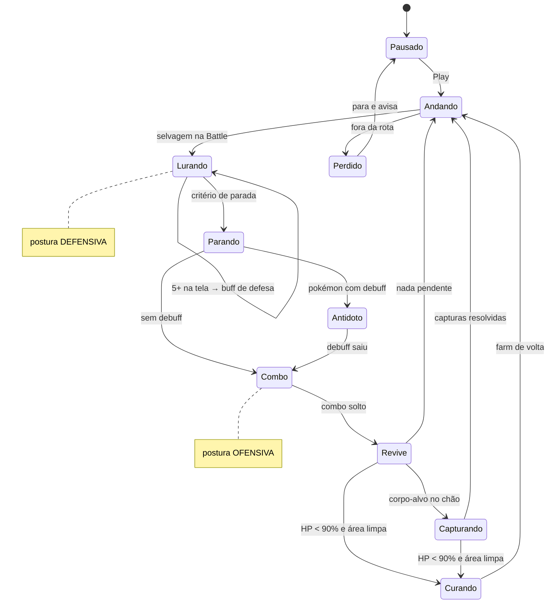

# Especificação das regras: OTP Bot v1.0

Fonte: respostas da **Anamnese — OTP Bot v1.0** (2026-10-09). O número entre colchetes, como **[Q31]**, aponta a pergunta.
Arquitetura em [`ARQUITETURA.md`](ARQUITETURA.md); etapas e estado do projeto em [`GUIA.md`](../GUIA.md).

Os valores marcados como *(config)* são padrões editáveis no console.

---

## 1. Ambiente

| Item | Regra |
|---|---|
| Cliente | Poke Alliance em **tela cheia** ou **janela sem borda**, modo **DirectX** [Q1, Q58] |
| Resoluções | **3440×1440** e **1920×1080**, em momentos diferentes; escala do Windows **100%** [Q2] |
| Monitor | O jogo fica **no monitor secundário**; você usa o primário ao mesmo tempo [Q3] |
| Área do jogo | Sem zoom; telas maiores só ganham painéis laterais [Q4]. *Conferir com prints: na calibração atual a área do jogo é 1360×714 no 3440 e 1124×588 no 1080.* |
| Hardware | RTX 5060 Ti **8 GB**, Ryzen 7 5700X3D, 32 GB de RAM; **jogo, bot e treino ao mesmo tempo** [Q5] |
| Uso | Só seu; depois também num PC mais leve, que **só roda** o bot (o treino fica no PC principal) [Q6] |
| Personagens | **1** [Q7] |
| Idioma | Console em português; o bot entende os textos do jogo em **português e inglês** [Q61] |

---

## 2. Ciclo da hunt (tipo 1, o único da v1.0)

O ciclo é uma máquina de fases. Segurança, sobrevivência e o modo Companion **interrompem qualquer fase**.

### 2.1 Andar e lurar
| Regra | Fonte |
|---|---|
| O personagem anda pela rota; os selvagens **seguem sozinhos**, não precisa atacar para puxar | [Q9] |
| Postura **defensiva** durante o lure | [Q14] |
| Com **5+ selvagens na tela**, usa o **buff de defesa** para terminar de juntar *(config: 5)* | [Q15] |
| A contagem vem da **Battle** (mais fácil de contar), conferida com a tela | [Q10] |

### 2.2 Critério de parada
Para quando **qualquer** destas condições acontecer [Q9, Q11, Q50]:
1. **N selvagens** juntos *(config: 8)*.
2. Chegou a um **ponto de matar** da rota com pelo menos **N mín.** selvagens *(config: 5)*. Os pontos de matar vêm da gravação: são onde você costuma parar.
3. **Algum selvagem ganhou o ícone de "longe do spawn"** ao lado do nome: para **na hora**, antes que ele suma.

### 2.3 Matar
| Regra | Fonte |
|---|---|
| Se o pokémon tiver **debuff**, usa o **antídoto** e **espera o debuff sair**; com debuff, as skills não saem | [Q39] |
| Antídoto em recarga: **espera** (nunca comba com debuff) | [Q39] |
| Postura **ofensiva** | [Q14] |
| **Combo = uma tecla** (o auto combo do jogo); a última skill é controle de grupo | [Q12, Q13] |
| Depois do combo: **revive** no pokémon para zerar a recarga | [Q8] |
| **Sobrou selvagem vivo** (shiny inclusive): **segue a rota**; ele fica preso pelo controle de grupo e morre na próxima volta | [Q8, Q13] |

### 2.4 Pokémon de dano desmaiou
- HP azul em 0: **revive e continua** [Q35].

---

## 3. Shiny, corpos e captura

| Regra | Fonte |
|---|---|
| Shiny vivo = **ícone ao lado do nome na Battle** + **cor diferente** do sprite | [Q17] |
| Corpo de shiny = **cor diferente** do corpo normal (cada shiny tem a sua) | [Q18, Q19] |
| Alvos de captura: **você escolhe no console** recortando o corpo morto que quer capturar | [Q20] |
| Pokébola: **você escolhe o sprite da bola** para shiny e para normal | [Q21] |
| Usar a bola: **hotkey da bola com o cursor sobre o corpo** (a bola tem *auto use*) | [Q22] |
| Confirmação: **mensagem no chat** (pt/en); o corpo some e, se capturou, o pokémon aparece | [Q23] |
| Falhou: tenta de novo até **N vezes** *(config: 3)* | [Q23] |
| **Capturar antes de seguir a rota** (a rota fica segurada) | [Q24] |
| Sem loot: o servidor coleta sozinho | [Q25] |
| Bolas acabaram: **só notificar** | [Q28] |
| Compra/reposição automática: **fora do escopo** | [Q29] |

---

## 4. Cura e troca de pokémon

| Regra | Fonte |
|---|---|
| Gatilho: **sua barra vermelha** (HP do jogador) | [Q30] |
| Cura quando o HP < **90%** *(config)* **e a box estiver morta e a área limpa** | [Q31, Q32] |
| Sequência: chama o **curador** → **rotação de cura** → **revive no curador** (zera a recarga) → chama o **pokémon de dano** | [Q31] |
| Curador e pokémon de dano: você aponta no console (recorte na Pokébar ou foto) | [Q33] |
| Troca de pokémon por **hotkey** | [Q34] |
| Não há cura por item; a cura passiva você mesmo mantém | [Q36] |

## 5. Debuff e antídoto

| Regra | Fonte |
|---|---|
| Debuffs: veneno, queimadura, paralisia, sono, confusão; **todos saem com o mesmo antídoto** | [Q37] |
| Aparecem **embaixo da barra de skills do pokémon** (nova região de calibração) | [Q38] |
| Com o pokémon fora, o debuff pega **só nele**; no jogador, só com o pokémon guardado | [Q40] |

---

## 6. Rota

| Regra | Fonte |
|---|---|
| O "mapa liberado" é só um arquivo que libera o minimapa para se orientar | [Q41] |
| **Gravação jogando:** você faz a hunt e o bot registra as coordenadas, onde você **para** (e por quanto tempo) e **todas as teclas** que você aperta | [Q42, Q47] |
| Movimento pelo **teclado numérico com Num Lock desligado**: 7 ↖ · 8 ↑ · 9 ↗ · 4 ← · 6 → · 1 ↙ · 2 ↓ · 3 ↘ | [Q43] |
| Posição pelas **coordenadas `x, y, z`** do canto do minimapa | [Q44] |
| Tipos de ponto: **andar**, **parar e lurar**, **parar e matar**, **escada** | [Q45] |
| Se perdeu (empurrado, travado, teleportado): **para e avisa** | [Q46] |
| **Várias hunts salvas**; cada hunt = rota + pokémon-alvo + regras | [Q47, Q58] |

---

## 7. Segurança e controle

| Regra | Fonte |
|---|---|
| **GM aparece como pokémon com nome diferente** (ex.: um Pikachu chamado "xyz"). Como cada hunt só tem uma espécie, **qualquer nome fora da espécie da hunt é suspeito** | [Q52, Q54] |
| Alertas obrigatórios: **jogador na tela**, **GM**, **shiny capturado** | [Q54] |
| GM ou perigo: **pausa sozinho**, avisa e **toca um alarme no console** | [Q55] |
| Sem pausas aleatórias nem limite de sessão (você pausa na mão) | [Q56] |
| **Modo Companion:** quando você assume o controle **no jogo**, a hunt pausa; volta só quando você clicar para retomar | [Q57] |

---

## 8. Aprendizado

| Regra | Fonte |
|---|---|
| Sem aprendizado por reforço no jogo; quatro peças: **visão**, **gravador de sessões**, **"aprender comigo"**, **otimizador** | [Q49] |
| **Eficiência** = mais selvagens mortos por hora (normais e shiny) com o **maior saldo positivo** do analisador de hunt do jogo | [Q48] |
| O otimizador **pode aumentar o lure**, mas **nunca** a ponto de um selvagem ganhar o ícone de "longe do spawn" | [Q50] |
| O otimizador **nunca** baixa o HP de cura abaixo do que você configurou | proposta |
| Você topa rotular imagens; o console terá a ferramenta com rotulagem automática | [Q51] |
| Visão por hunt: **espécie da hunt, a versão shiny, o seu pokémon e os corpos** | [Q52] |
| O treino roda **jogando ou com o PC livre**; gravar a sessão começa quando você clicar | [Q53] |
| O otimizador **sugere**; você **aceita ou recusa** na aba Aprender | proposta do documento |

---

## 9. Console e executável

| Regra | Fonte |
|---|---|
| Layout com as abas novas **Hunt**, **Visão/IA** e **Aprender** | [Q58] |
| Aba **Sessão**: selvagens mortos, bolas jogadas, dinheiro positivo e negativo, itens usados | [Q58] |
| Aba **Contas/Launcher**: abrir o jogo, escolher **DirectX**, escolher a conta; **auto-login** testando antes a conta secundária e depois entrando com a principal e indo para a hunt | [Q58] |
| Console em **janela própria** e também **overlay** sobre o jogo | [Q60] |
| **Instalador** com **atualização automática** | [Q59] |

---

## 10. Prioridade da v1.0 [Q62]

1. Visão vendo selvagens, corpos e shiny
2. Captura só de shiny
3. Rota por coordenadas + lure e parada
4. Cura e troca de pokémon validadas no jogo
5. Debuff + antídoto antes do combo
6. Aprendizado e otimização
7. Executável empacotado

## 11. v2.0: deixar preparado [Q63]

- **Segundo tipo de hunt** [Q8].
- **Endgame com os 6 pokémons:** vários pokémons de lure e de dano em revezamento. Lura com o 1º → para com 8 → bate →
  chama o 2º encostado na box → mata → shinies sobrevivem à 1ª volta → afasta um pouco → espera a recarga → chama o próximo
  de lure → repete → depois volta para o primeiro.
- Vários personagens.

A arquitetura prevê isso com **equipe com papéis** (lure, dano, curador) e **táticas por ponto**, em vez de "um pokémon
de farm" fixo.

---

## 12. Pendências

| # | O que falta | Para quê |
|---|---|---|
| P1 | **Material do jogo** (prints, vídeo de 5 a 10 min) | Dataset da visão, calibração da Battle, debuff, coordenadas |
| P2 | Tabela de itens [Q26] em branco: poção, revive, antídoto, bolas, teclas | Atalhos e sprites |
| P3 | Tamanho real da área do jogo nas duas resoluções [Q4] | Os sprites mudam de tamanho? |
| P4 | Texto exato das mensagens de captura (sucesso e falha) em pt/en [Q23] | Confirmar a captura |
| P5 | **Teste de envio de teclas para o jogo sem foco** (ver `ARQUITETURA.md`, risco R1) | Jogar no monitor secundário enquanto você usa o primário |
| P6 | Duração de uma volta da rota [Q16] | Métrica de referência (dá para medir com a gravação) |
